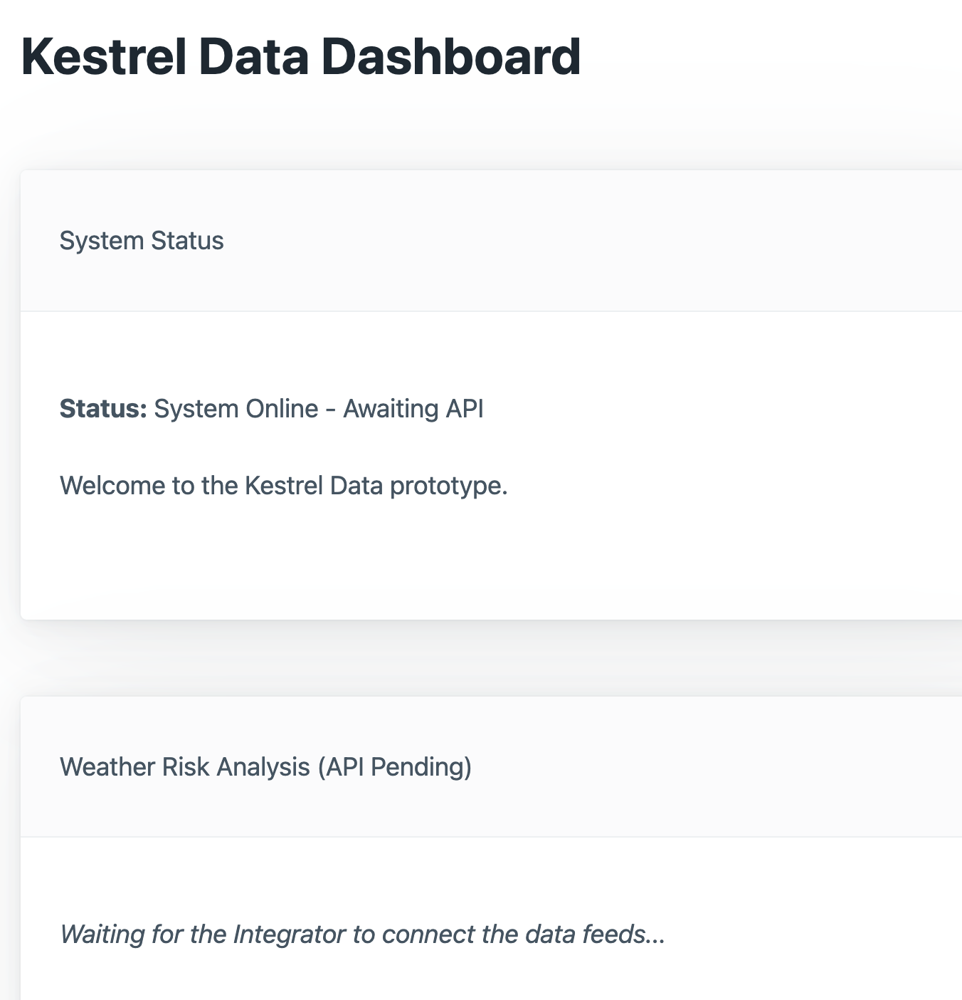

# Kestrel Data Weather Risk Dashboard — User Manual

**Version:** 1.0 (Final Release)  
**Target Audience:** Deb (Office & Operations Manager), Priya, Marcus, and logistics operational staff.

---

## 1. Introduction

The **Kestrel Data Weather Risk Dashboard** is a browser-based decision-support tool. It eliminates manual spreadsheet searches by aggregating live geographical and atmospheric data into an automated risk assessment for any requested location.

The application requires zero client installation for end-users and runs entirely in modern web browsers.

---

## 2. System Architecture & Prerequisites

For local operations and internal hosting:
* **Operating System:** Cross-platform (macOS, Windows 10/11, Linux)
* **Python Runtime:** Python 3.11 or newer
* **Network Access:** Outbound HTTPS access to:
  * Mapbox Geocoding API (`https://api.mapbox.com`)
  * OpenWeatherMap API (`https://api.openweathermap.org`)

---

## 3. Installation & Configuration (For Deb / Technical Admin)

1. **Clone the repository:**
   ```bash
   git clone https://github.com/amisha284/kestrel-weather-dashboard.git
   cd kestrel-weather-dashboard
   ```

2. **Initialize Python virtual environment:**
   ```bash
   python3 -m venv venv
   source venv/bin/activate  # On Windows: venv\Scripts\activate
   pip install -r requirements.txt
   ```

3. **Configure API Credentials:**
   Copy the `.env.example` file to create a working `.env` file:
   ```bash
   cp .env.example .env
   ```
   Open `.env` in any text editor and supply your keys:
   ```ini
   MAPBOX_ACCESS_TOKEN=your_mapbox_token_here
   OPENWEATHER_API_KEY=your_openweathermap_key_here
   ```
   *(Note: The application will safely alert the user on the dashboard if credentials are missing or expired without leaking secrets).*

4. **Launch the Dashboard Server:**
   ```bash
   python3 -m uvicorn app.main:app --reload --port 8000
   ```
   Access the dashboard by navigating to `http://127.0.0.1:8000` in Google Chrome, Safari, Firefox, or Edge.

---

## 4. Using the Dashboard (Step-by-Step)


*Figure 1: Kestrel Data Browser Interface.*

### Step 1: Search a Location
1. In the **Location** field, type the city, regional hub, or distribution center.
2. *Best Practice:* Include the country name for disambiguation (e.g., `Perth, Australia` rather than `Perth`; `Chicago, US` rather than `Chicago`).
3. Click **Check weather** (or press `Enter`).

### Step 2: Interpreting the Weather Report
When the location is resolved, the dashboard presents two structured cards:

1. **Current Weather Data:**
   * **Location & Coordinates:** Displays the standardized address resolved by Mapbox along with precise latitude and longitude.
   * **Conditions & Temperature:** Atmospheric state (e.g., overcast clouds, light rain) and ambient temperature in °C.
   * **Wind Speed:** Surface velocity in meters per second (m/s).
   * **Hourly Rainfall:** Precipitation volume in mm/h (displays *"Not reported"* if no recent rainfall is recorded).
   * **Observation Timestamp:** The official UTC timestamp of the measurement.

2. **Weather Risk Analysis:**
   The dashboard calculates a composite risk rating:
   * **LOW RISK (Green):** Normal operational baseline. No hazardous factors detected.
   * **MEDIUM RISK (Yellow):** Caution advised. Triggered by moderate wind (≥ 8 m/s) or sustained rainfall (≥ 2.5 mm/h).
   * **HIGH RISK (Red):** Disruption hazard. Triggered by severe wind (≥ 15 m/s), heavy rainfall (≥ 7.5 mm/h), or active thunderstorm codes (200–299).
   * **Reasoning Bullet Points:** Outlines the explicit factors causing an elevated risk rating.

---

## 5. Troubleshooting & Error Messages

| Displayed Message | Cause | Resolution |
| :--- | :--- | :--- |
| *"Enter a location name, such as Perth, Australia."* | Blank or whitespace-only search submitted. | Provide a valid city or address string. |
| *"No matching location was found. Try adding a country name."* | Mapbox could not geocode the input. | Check spelling or append state/country (e.g., `Freo, WA, Australia`). |
| *"Set MAPBOX_ACCESS_TOKEN / OPENWEATHER_API_KEY in your environment..."* | Credentials missing from `.env`. | Verify keys exist in `.env` and restart Uvicorn. |
| *"The API rejected the credentials. Check your key..."* | Invalid or expired API token. | Re-issue API keys from the provider portal. |
| *"The API request limit was reached."* | Free-tier request quota exceeded (HTTP 429). | Wait 60 seconds or upgrade provider rate limits. |
| *"The API request timed out."* | Network delay exceeding 10 seconds. | Check internet connectivity and retry. |

---

## 6. Developer Endpoints & Handover

FastAPI automatically generates live interactive documentation for internal developers:
* **Interactive Swagger UI:** `http://127.0.0.1:8000/docs`
* **OpenAPI Specification:** `http://127.0.0.1:8000/openapi.json`